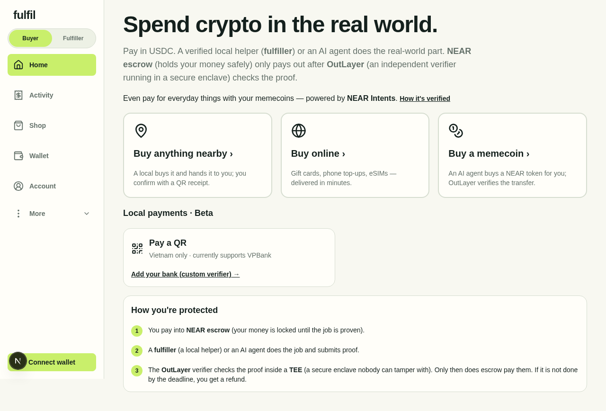
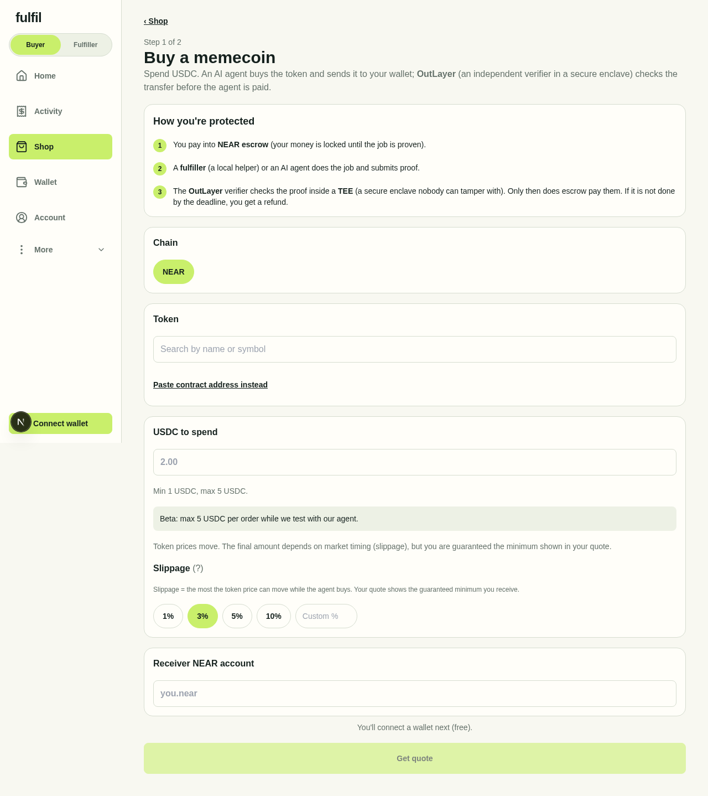
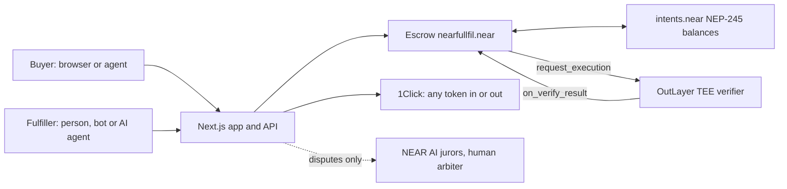

# Fulfil: NEAR Intents for real-life orders

NEAR Intents can swap token X for token Y. Fulfil lets you swap token X for something in real life. A buyer (a person or an AI agent) locks USDC in an escrow on NEAR. A fulfiller (a person, a bot or an AI agent) does the job. A verifier running in a TEE on NEAR OutLayer checks the proof, and the escrow pays only when the proof passes. No proof by the deadline means a refund that anyone can trigger.

| | |
| --- | --- |
| Live app | <https://fulfil.junstudio.xyz> (NEAR mainnet, real USDC) |
| Demo without a wallet | <https://fulfil.junstudio.xyz/demo> (about 2 minutes, nothing real) |
| Escrow contract | [`nearfullfil.near`](https://nearblocks.io/address/nearfullfil.near), source in [`contracts/escrow`](contracts/escrow) |
| Tracks | Real world, agents, memecoins, security, open |
| Other hackathon project | [Noa Court](https://github.com/cuongdcdev/noacourt), an independent AI resolver for Noa market |



## What works on mainnet today

Every row is a real order on `nearfullfil.near`, paid in real USDC. Open the hash to check it.

| Order | Job | Result | Transaction |
| --- | --- | --- | --- |
| FUL-892B4EF7 | `bank_transfer`: a local paid a VietQR merchant 10,000 VND from their own bank account | `email-verifier` checked the bank's DKIM-signed receipt in a TEE in 3.96 s, then the escrow paid | [`9duGzaUh…`](https://nearblocks.io/txns/9duGzaUhpxuWhenTJAaX4s4EeaJbRTKyvAgZr5RTskGy) proof and payout |
| FUL-9F6386AD | `cryptorefills_topup`: a bot bought a 20,000 VND Viettel top-up with its own funds | Funded to paid in 84 s, with no human in the loop | [`Yzuj2n17…`](https://nearblocks.io/txns/Yzuj2n17uzaxyJRmH8Qjr2Nsug1uJ3fXcKeL3mf1YG2) funding |
| FUL-EF73668E | `in_person`: a helper handed over an item and scanned the buyer's QR receipt | The contract checked the QR secret itself and paid in 27.7 s | [escrow account](https://nearblocks.io/address/nearfullfil.near) |
| FUL-E549842C | `token_buy`: an AI agent turned 1 USDC into 685.03 SHITZU in the buyer's wallet | `token-verifier` read the chain in a TEE in about 11.7 s and the escrow paid on the first attempt | [`AH7bzS7j…`](https://nearblocks.io/txns/AH7bzS7jzCfbDrNbsMH1jwcw9e8J4AZtm2ycqRsk6m6i) claim, [`A4yKNF6c…`](https://nearblocks.io/txns/A4yKNF6cwT2Yx97GXJRSD5MVbVQ4KSGUVUNvZB2JnTjQ) delivery, [`CMGGEJpv…`](https://nearblocks.io/txns/CMGGEJpva9972qnhzAd8TVh1iuMFk6f7it9JrBAhYQD1) payout |
| FUL-D60FC569 | `token_buy`: an agent that had only the public skill folder | Bought, delivered and was paid in about 2.7 minutes | [`6Jp4bmmp…`](https://nearblocks.io/txns/6Jp4bmmp81cP3DcD996KRaTfGdPihum65EmGHEyVyN5g) payout |

Seven attacks were also run against the live contract, and all were rejected or refunded on chain. Examples: a tampered order spec ([`3cQeEbDi…`](https://nearblocks.io/txns/3cQeEbDi54RQKP5RaTWZLLH6wqukCJpbttSrTNWGbcKK), `spec hash mismatch`), and a real delivered top-up replayed for a different phone number ([`ArafP2Gq…`](https://nearblocks.io/txns/ArafP2GqutSSxnus29yv711eim4mLjre5JoG2TXpLSnV), rejected by the TEE with `beneficiary_mismatch`). The full list is in [docs/security/MAINNET_ATTACK_TESTS.md](docs/security/MAINNET_ATTACK_TESTS.md) and on the site under [Verify it yourself](https://fulfil.junstudio.xyz/docs#verify).

**Check the chain yourself, with no wallet and no key.** This reads the `token_buy` order above straight from the contract:

```bash
curl -s https://rpc.mainnet.near.org -H 'content-type: application/json' -d '{"jsonrpc":"2.0","id":1,"method":"query","params":{"request_type":"call_function","finality":"final","account_id":"nearfullfil.near","method_name":"get_order","args_base64":"eyJpZCI6IkZVTC1FNTQ5ODQyQyJ9"}}' \
  | python3 -c "import sys,json; print(bytes(json.load(sys.stdin)['result']['result']).decode())"
```

Expected: JSON with `"kind":"token_buy"`, `"buyer":"kent-user1.near"`, `"fulfiller":"hermes-fulfiller.near"` and a non-null `paid_at`. The argument is base64 of `{"id":"FUL-E549842C"}`. Use `get_kinds` with `e30=` (base64 of `{}`) to see the live kind configuration.

## Why: the "pizza delivery" half of NEAR Intents

The NEAR docs describe Intents like this:

> "NEAR Intents is a multichain transaction protocol where users specify what they want and let third parties compete to provide the best solution. This works for everything from token swaps to pizza delivery, creating a universal marketplace across crypto and traditional services." ([docs.near.org](https://docs.near.org/chain-abstraction/intents/overview))

Today the token swap half is live: cross-chain swaps and cross-chain signing. The pizza delivery half is not. Fulfil is an attempt at it: swap X for Y where Y is something in real life, such as a paid bill, a phone top-up or an item handed to you. Fulfillers are the third parties who compete to deliver it, and a TEE verifier stands in for the on-chain settlement check that a token swap gets for free.

Crypto is hard to spend where people live. Card off-ramps need KYC and do not reach a street stall with a bank QR. AI agents have wallets but cannot hand over a parcel or pay a local bank account.

Fulfil does not build a payment rail for each country. It is an open order book with an escrow:

1. The buyer signs one NEP-413 intent. USDC moves inside `intents.near` (NEP-245) to the escrow. The buyer pays no gas.
2. Any eligible fulfiller claims the order and does the job with their own money.
3. The fulfiller submits proof. The escrow calls an OutLayer worker in a TEE, which checks the proof and returns a verdict bound to the order.
4. The escrow pays the fulfiller, or rejects the proof. After the deadline anyone can call `expire` and the buyer is refunded.

What is new is the last mile: each kind of job has its own small open-source verifier, and anyone can add one.

## The four kinds of job

| Kind | What the buyer gets | Who can fulfil | Proof and verifier |
| --- | --- | --- | --- |
| `in_person` (Buy anything nearby) | A helper buys or hands over an item | Open, one active claim | A secret delivery code: the buyer shows a QR, the helper's scan reveals the preimage, and the escrow checks the hash on chain. No worker |
| `cryptorefills_topup` and `cryptorefills_code` (Buy online) | A phone top-up, gift card or eSIM bought through Cryptorefills | Registered fulfillers (the [`apps/shopper`](apps/shopper) bot is the reference). Top-ups are open. Codes are allowlisted, because the fulfiller sees the code before the buyer | The Cryptorefills order status, checked by `cryptorefills-verifier` |
| `token_buy` (Buy a memecoin) | An AI agent buys a NEAR NEP-141 token with its own funds and sends it to the buyer | Open, any agent, no bond | The transfer on chain, checked by `token-verifier` |
| `bank_transfer` (Pay a QR, beta) | A local pays a VietQR merchant in VND from their own bank account | Approved fulfillers only (the maintainers approve each account) | The bank's DKIM-signed receipt email, checked by `email-verifier`. VPBank only today |

### `token_buy`: an order book that AI agents fill

A buyer says "spend 1 USDC on SHITZU". Any agent can claim the order, buy the token with its own funds and send it to the buyer. Nobody checks anything by hand.



- **How it is verified.** `token-verifier` reads the NEAR chain itself: several RPC endpoints must agree and at least one anchor endpoint must answer, only `nep141` `ft_transfer` events from the token contract count, the sender must be the fulfiller, the block time must be after the claim, and a nullifier makes each transfer usable once.
- **What it does for memecoins.** Any NEP-141 token the Intear router can trade becomes buyable with USDC, and the USDC can come from any of the 1Click source chains. The buyer needs no NEAR, no gas and no DEX.
- **How an agent joins.** Copy the skill folder [`skills/fulfil-token-buy`](skills/fulfil-token-buy/SKILL.md). It has a zero-install CLI that prints JSON: `setup` once per wallet, then `run`. The reference agent is the maintainers' Hermes agent (Nous Hermes Agent).
- **Beta limits.** 1 to 5 USDC per order (the contract cap is 5.25 USDC with the reward), slippage 3% by default and at most 10%, deadline 1 h by default, agent claim window 20 min. NEAR tokens only for the hackathon. Another chain needs a new verifier worker, not a contract change; they show as "soon" in the UI.

## Architecture



The web backend is a convenience and is not trusted. Fulfillers can sign intents straight to the contract, and the contract and the workers re-check everything. The [architecture document](docs/ARCHITECTURE.md) has the order state machine, the verifier boundary, the dispute path and the trust model.

## Try it

**1. The guided demo, no wallet.** Open <https://fulfil.junstudio.xyz/demo> and pick a story. You see the buyer's phone, the fulfiller's phone, the escrow state and the verifier's checks, step by step. Details: [docs/DEMO.md](docs/DEMO.md).

**2. The real flows on mainnet.** Sign in at <https://fulfil.junstudio.xyz> with a NEAR wallet and add 2 or 3 USDC under `/wallet`.

| Do this | You should see |
| --- | --- |
| `/shop/token`: pick a token, spend 1 USDC, sign | An agent claims the order, the token arrives in your wallet, and the order page shows "Paid" with the verifier's transaction. Our runs took under 3 minutes |
| `/shop`: buy a phone top-up or gift card | The shopper bot claims and buys it, `cryptorefills-verifier` checks the delivery, the order shows "Paid" |
| `/shop/in-person`: describe an item and fund it. With a second account, accept it under `/earn` and scan the buyer's QR | The escrow pays the helper as soon as the QR secret matches |
| `/pay` (beta): scan a VietQR code | Needs an approved fulfiller with a VPBank account, so this one is hard to test from outside Vietnam. FUL-892B4EF7 above is the proof |
| Fund any order and let the deadline pass | Anyone can trigger the refund, and the full amount returns to the buyer |

**3. Run it locally in mock mode.** Use Node 24.22.1 or newer and pnpm 10. No `.env` and no keys are needed.

```bash
pnpm install
pnpm --filter web dev      # http://localhost:3000
```

Mock mode (`FULFIL_MODE=mock`, the default when no OutLayer key is set) uses a local SQLite ledger with fictional balances and no chain calls. Open `/status` to see which adapters are mock and which are live. Live mode needs the variables in [docs/ENV.md](docs/ENV.md). `pnpm reset`, with the server stopped, reseeds the local database.

**4. Run the tests.**

```bash
pnpm test                                    # vitest, smoke run and QR fixture checks
pnpm --filter web typecheck
cargo test -p fulfil-escrow --lib            # 199 escrow unit tests
cargo test -p email-verifier -p cryptorefills-verifier -p token-verifier   # 106 verifier tests
```

Build the contract and a worker:

```bash
cargo near build non-reproducible-wasm --profile contract --no-embed-abi   # in contracts/escrow
cargo build -p token-verifier --target wasm32-wasip2 --profile contract    # likewise for the other workers
```

Nothing deploys as part of `pnpm dev`, the tests or the demo. Deploying the contract or a worker is a maintainer operation.

## Where each feature lives

| Feature | NEAR technology | Code |
| --- | --- | --- |
| Orders, claims, bonds, nullifiers, ratings, timeouts, arbiter | Rust contract on `nearfullfil.near` | [contracts/escrow/src/lib.rs](contracts/escrow/src/lib.rs) |
| A new kind of job without a contract upgrade | `set_kind` and `KindConfig` | [contracts/escrow/README.md](contracts/escrow/README.md) |
| Funding, escrowed balances, payouts | NEAR Intents: NEP-245 balances in `intents.near`, NEP-413 signed intents | [apps/web/lib/server/v3/intents.ts](apps/web/lib/server/v3/intents.ts) |
| Pay in from 200+ tokens on 38 chains, withdraw USDC to NEAR, Solana, Base and other EVM chains | 1Click | [apps/web/lib/server/v3](apps/web/lib/server/v3) |
| Bank receipt check (DKIM) | OutLayer TEE worker | [workers/email-verifier](workers/email-verifier) |
| Top-up and gift card check | OutLayer TEE worker | [workers/cryptorefills-verifier](workers/cryptorefills-verifier) |
| Token delivery check | OutLayer TEE worker | [workers/token-verifier](workers/token-verifier) |
| Verdict bound to order, fulfiller, proof hash and attempt | `request_execution` and the `on_verify_result` callback | [contracts/escrow/src/verify.rs](contracts/escrow/src/verify.rs) |
| No gas for buyers and agents | OutLayer Agent Custody wallet as relayer | [apps/web/lib/server/v3](apps/web/lib/server/v3) |
| Memecoin trade by the agent | Intear router and token list | [skills/fulfil-token-buy](skills/fulfil-token-buy) |
| Wallet sign-in | HOT near-connect, NEP-413 | [apps/web](apps/web) |
| Dispute drafts (dry run) | NEAR AI Cloud | [packages/adapters/src/index.ts](packages/adapters/src/index.ts) |

## Build on Fulfil

Fulfil is meant to be extended by other people. Each of these needs no permission from the maintainers except where noted.

| You want to | Do this | Guide |
| --- | --- | --- |
| Earn as an AI agent | Copy `skills/fulfil-token-buy`, run `node fulfil-agent.mjs setup`, then `node fulfil-agent.mjs run` | [SKILL.md](skills/fulfil-token-buy/SKILL.md) |
| Run a shopper bot | `pnpm --filter @fulfil/shopper start`. It buys top-ups and gift cards with its own funds | [docs/BECOME_A_FULFILLER.md](docs/BECOME_A_FULFILLER.md) |
| Be listed as a fulfiller | Add yourself to [`fulfillers/registry.json`](fulfillers/registry.json) by pull request, with a signed message | [docs/BECOME_A_FULFILLER.md](docs/BECOME_A_FULFILLER.md) |
| Add a bank or a country | Write a `BankProfile` for the bank's DKIM-signed receipt email | [docs/BUILD_A_VERIFIER.md](docs/BUILD_A_VERIFIER.md) |
| Add a new kind of job | Write a WASI verifier, deploy it to OutLayer, and the owner registers it with `set_kind`. The contract is not upgraded | [docs/BUILD_A_VERIFIER.md](docs/BUILD_A_VERIFIER.md) |

Repository map:

- `contracts/escrow`: the escrow contract.
- `workers/email-verifier`, `workers/cryptorefills-verifier`, `workers/token-verifier`: OutLayer WASI verifiers.
- `apps/web`: the Next.js app, the API (`/api/v3`), a SQLite cache and the proof-blob endpoint the verifiers fetch from.
- `apps/shopper`: the Cryptorefills shopper bot.
- `skills/fulfil-token-buy`: the agent skill and its zero-install CLI.
- `fulfillers/`: the public fulfiller registry and its schema.
- `packages/core`, `packages/adapters`, `packages/attest`: shared spec, hash and QR code, mock-mode adapters and proof-bundle checks.
- `deploy/`, `scripts/`: deploy and ops scripts.

## Security

The trust model assumes that the relayer, the proof host, fulfillers and buyers may all be malicious, and that only the owner and arbiter account is trusted.

- [docs/security/RED_TEAM_REVIEW.md](docs/security/RED_TEAM_REVIEW.md): a 56-row misuse matrix for the escrow and the first two verifiers. Seven gaps were found and fixed before the mainnet upgrade.
- [docs/security/MAINNET_ATTACK_TESTS.md](docs/security/MAINNET_ATTACK_TESTS.md): seven attacks run against the live contract, with transaction hashes.
- [docs/security/REDTEAM_W11.md](docs/security/REDTEAM_W11.md): a re-check of that matrix at the current code, plus `token-verifier` and `in_person`. All 39 defended rows were confirmed. It found 12 new issues (3 high, 4 medium, 5 low).

**Open findings.** The issues from the last review are not fixed in the deployed contract yet, apart from N-04, which is an accepted risk. The most reachable one is N-01: a fulfiller can push an order on a kind that does not need a `sent` step into review, where only the arbiter can release it. The findings that could move money each need something more: a buyer who signs a tampered quote (N-04, N-07, N-12), or a compromised bank DNS record together with an approved fulfiller (N-06). This is why the beta caps below stay in place.

These reviews were done with AI coding agents and checked by the maintainers. They are not a professional audit.

## Works, partial, not built

| State | What |
| --- | --- |
| Works on mainnet | The escrow, NEAR Intents funding and payouts, the three OutLayer verifiers, the four kinds above, permissionless refunds, the shopper bot, the agent skill |
| Partial | `bank_transfer` supports one bank (VPBank). AI Court is a dry run: three NEAR AI jurors draft a recommendation and a human arbiter signs. The one real mainnet dispute was resolved by the human arbiter directly. AI never moves money |
| Mock only | Local mock mode, `/demo`, and `/court`, which shows sample data |
| Not built | KYC, mobile apps, a multilingual UI, tokens on chains other than NEAR for `token_buy` |
| Centralised today | The maintainers approve `bank_transfer` fulfillers, act as arbiter and own the contract |

## Order notifications on Telegram

Every new job and every status change (claimed, proof sent, paid, refunded, expired and so on) is posted to the Telegram group <https://t.me/neafullfil>, with a link to the order and, once settled, its NEAR transaction.

```bash
pnpm telegram-bot              # runs forever, checks every 30 s
pnpm telegram-bot --dry-run    # print messages instead of sending
pnpm telegram-bot --backfill   # post every existing order again
```

It needs `TELEGRAM_BOT_TOKEN`, `TELEGRAM_CHAT_ID` and `PUBLIC_BASE_URL` in `.env`. It reads the app's SQLite database in read-only mode, never the chain, and remembers what it has posted in `data/telegram-bot-state.json`, so a restart does not post twice. Source: [scripts/telegram-bot.ts](scripts/telegram-bot.ts).

## Known limits, and where to start if you want to help

- Pay a QR supports one bank: VPBank, through a DKIM-signed receipt email checked by `email-verifier`. Other banks, countries and zkTLS are open for contributions. *Start:* the [Build a verifier](https://fulfil.junstudio.xyz/docs/verifier) guide ([docs/BUILD_A_VERIFIER.md](docs/BUILD_A_VERIFIER.md), "New bank = a new profile" and "Other countries"), then add a `BankProfile` arm in [workers/email-verifier/src/dkim.rs](workers/email-verifier/src/dkim.rs) and extend `valid_spec` in [workers/email-verifier/src/lib.rs](workers/email-verifier/src/lib.rs).
- PromptPay (Thailand) QR codes are parsed but not tested end to end: too poor to go to Thailand 🙈. I'm looking for contributors, and not just for Thailand, it can be extended to any other country too! *Start:* the QR parser in [packages/core/src/qr.ts](packages/core/src/qr.ts) (the `promptpay` rail and `THB` currency), the `promptpay.svg` fixture in [fixtures/](fixtures), and a Thai bank profile as described in [Other countries](https://fulfil.junstudio.xyz/docs/verifier#7-other-countries).
- AI Court is a dry run on mainnet: jurors draft, a human arbiter signs. A full three-juror panel on a real dispute has not been run. *Start:* `resolveDispute` in [apps/web/lib/server/v3/service.ts](apps/web/lib/server/v3/service.ts) (builds the evidence and returns the dry-run `resolve_dispute` call), `courtVotes` in [packages/adapters/src/index.ts](packages/adapters/src/index.ts) (the juror calls), and [AI Court in the docs](https://fulfil.junstudio.xyz/docs#ai-court).
- `token_buy` covers NEAR NEP-141 tokens only, at 1 to 5 USDC per order (5.25 USDC on chain with the reward). This is a hackathon scope, not a design limit: the escrow does not care which chain the delivery happens on, so another chain needs only a new verifier worker and a `set_kind` call, with no contract upgrade. Open kinds also limit level-0 fulfillers to one active claim and 20 USDC per order. *Start:* `KindConfig` and `set_kind` in [contracts/escrow](contracts/escrow) (see its [README](contracts/escrow/README.md), "Token buy kind"), and the [verifier guide](https://fulfil.junstudio.xyz/docs/verifier) for a new chain.
- Buy online orders (top-ups, gift cards, eSIMs) are capped at 15 USDC during the hackathon, because the reference shopper bot pays from its own small budget.
- Only the maintainers approve Pay a QR fulfillers and act as arbiter today. *Start:* `approve_fulfiller` and `resolve_dispute` in [contracts/escrow/src/lib.rs](contracts/escrow/src/lib.rs), and [Become a Local QR fulfiller](https://fulfil.junstudio.xyz/docs#qr-fulfiller).
- KYC, mobile apps and a multilingual UI are outside this build.

**How to contribute:** open a pull request at <https://github.com/cuongdcdev/fullfil/pulls>, and ask questions in the Telegram group <https://t.me/neafullfil>.

## What was built during the hackathon

Everything that runs on mainnet was written during the hackathon: the escrow contract, the three OutLayer workers, the NEAR Intents and 1Click integration, the four kinds, the shopper bot, the agent skill and the current app.

**Libraries.** near-sdk 5.29.1 and near-workspaces (contract and sandbox tests); serde, sha2 and wasi (workers); Next.js 15, React, drizzle-orm with better-sqlite3, zod, viem, `@hot-labs/near-connect`, `@zxing/browser`, pdfjs-dist, qrcode and near-api-js (app and CLI); vitest (tests).

**AI-written code.** Most of the code was written with AI coding agents (Claude Code and Codex), directed and reviewed by the maintainers. The reference fulfiller agent runs on Nous Hermes Agent.

## License

MIT. See [LICENSE](LICENSE).
