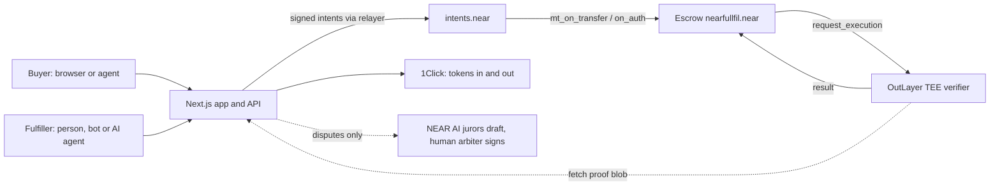
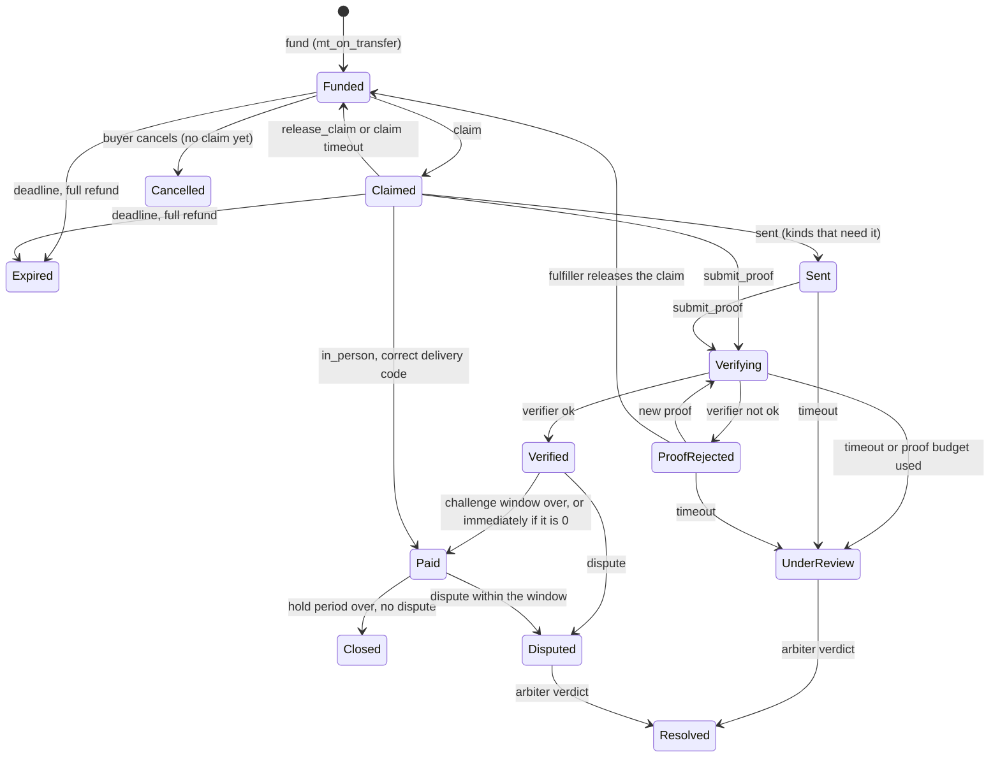

# Fulfil architecture and trust model

Fulfil lets anyone pay for real-world things with crypto. A buyer escrows USDC, a fulfiller (a person, a bot or an AI agent) does the job, a verifier running in a TEE on NEAR OutLayer checks the proof, and the escrow contract pays out only when the proof is verified. If nobody delivers, the buyer is refunded.

The escrow is `nearfullfil.near` on NEAR mainnet. It holds NEP-245 balances inside `intents.near` (NEAR Intents), so a buyer can fund an order from any token on any chain that 1Click supports.



## Kinds

A **kind** is a set of escrow rules (`KindConfig`) plus one verifier. The maintainers (the contract owner account `nearfullfil.near`) register a kind with `set_kind`; no contract upgrade is needed to add one.

| Kind | Access | Verification |
| --- | --- | --- |
| `bank_transfer` (Pay a QR, VPBank) | Approved fulfillers | `email-verifier` checks the bank's DKIM-signed receipt email |
| `cryptorefills_topup` | Open to registered fulfillers, one active claim, 20 USDC at level 0 | `cryptorefills-verifier` checks the Cryptorefills order |
| `cryptorefills_code` | Allowlist (the fulfiller sees the code before the buyer) | `cryptorefills-verifier` |
| `in_person` | Open, one active claim | On chain, no worker: the claimer reveals a secret delivery code and the escrow checks its hash |
| `token_buy` | Open, one active claim, no bond | `token-verifier` reads the NEAR chain |

The fields of `KindConfig` (`access`, `needs_sent`, timeouts, claim and value limits) are listed in the [escrow contract README](../contracts/escrow/README.md).

## Order state machine

Statuses come from the contract (`Status` in `contracts/escrow/src/types.rs`).



Rules the contract enforces:

- **Spec lock.** Funding carries a `spec_hash`; `submit_proof` must present the exact spec, whose hash is recomputed.
- **Attempts.** Each claim allows 3 proof submissions and each order 6. Every accepted submission consumes one, even if OutLayer fails or its callback is late.
- **Nullifiers.** A successful verification records a nullifier (for example `sha256("near_ft:" + tx_hash)` for `token_buy`), so a proof pays once.
- **Timeouts.** Anyone can trigger `expire` (a funded or claimed order past its deadline refunds the buyer in full) and `timeout`. An order with money in flight (`Sent`, `ProofRejected`, or a timed-out `Verifying`) goes to `UnderReview` instead of an automatic refund.
- **Dispute.** Allowed after verification or payment within the challenge and hold window, and from `UnderReview`. Only the arbiter resolves it, with a `buyer`, `fulfiller` or `split` verdict.
- **Ratings.** After payment each side can rate the other once, within the rating window.

## Verifier boundary

The escrow never judges a proof itself. It hands the proof to a verifier and acts only on a strict result.

```text
fulfiller --submit_proof(order_id, proof_sha256, spec)--> escrow
escrow: checks sha256(spec) == spec_hash, order state, attempt limits
escrow --request_execution(source = verifier_source, input_data, secrets_ref)--> OutLayer
OutLayer runs the WASI worker in a TEE: stdin = input JSON, stdout = one JSON line
escrow.on_verify_result(order_id, attempt, verify_seq, expected_fulfiller, expected_proof_sha256):
   ok + the three identifiers echoed exactly + completed_at_ns after the claim
   + an unused 64-hex nullifier  -->  Verified, then Paid (the fulfiller is paid, the nullifier is recorded)
   otherwise                     -->  ProofRejected
```

- The callback checks all five arguments against the current `Verifying` order. A late or duplicate callback logs `stale verify result ignored` and changes nothing.
- The proof itself (an `.eml` file, a Cryptorefills order token, a transaction hash) lives in a proof blob the worker fetches from the app by hash, with a bearer token held as an OutLayer secret. The worker checks the bytes against `proof_sha256`.
- A verifier output carries no personal data, because it is written on chain.
- Anyone can add a bank or a new kind by writing a verifier: see [Build a verifier](BUILD_A_VERIFIER.md). Contributors do not deploy their own project; maintainers review, deploy it under `nearfullfil.near`, pin it by hash and point a kind at it.

| Worker | Checks |
| --- | --- |
| `email-verifier` | DKIM signature of the bank domain, amount, merchant hash, order code in the note, email time after the claim |
| `cryptorefills-verifier` | The order exists, is done, has the delivery expected by the spec (beneficiary hash, product, value), and matches the order id |
| `token-verifier` | `EXPERIMENTAL_tx_status` on several RPCs that must agree (anchor RPCs included), only `nep141` `ft_transfer` events from the token contract, signer is the fulfiller, amount at least `amount_out`, block time after the claim |

## Token buy flow

1. The buyer funds `{amount_out, receiver, token_contract, v}` with USDC plus a reward. The beta cap is 5.25 USDC per order including the reward.
2. An agent claims it (open access, one active claim, no bond, 20 minute claim and proof windows).
3. The agent buys the NEP-141 token with its own funds through the Intear router and sends it to the receiver with a plain `ft_transfer` in a separate transaction.
4. It uploads `{order_id, tx_hash}` as the proof blob and calls `submit_proof`.
5. OutLayer runs `token-verifier`; `on_verify_result` pays the agent, or the deadline refunds the buyer.

The OutLayer Agent Custody wallet relays transactions, so buyers and agents sign NEP-413 messages and never pay gas.

## In-person flow

The buyer funds an order whose spec holds the item, the area, the price and `delivery_hash`, the hash of a secret code that stays in the buyer's browser. When the helper hands over the item, the buyer shows a QR containing the code. The claimer calls `confirm_delivery` with the 64 hex character code; the escrow hashes it, compares it with the stored hash and pays. Wrong codes consume one of six attempts. No worker is involved, so this kind verifies fully on chain.

## Dispute path (AI Court)

1. A buyer or fulfiller opens a dispute on chain, or an order lands in `UnderReview`. The escrow holds the money.
2. The resolve endpoint (protected by the arbiter admin token) builds the evidence file and asks three NEAR AI Cloud models to act as jurors, with reasons.
3. It returns a **dry-run** recommendation: a proposed verdict and the exact `resolve_dispute` call. With `ARBITER_ENABLED` unset it submits nothing.
4. The human arbiter reads it and signs `resolve_dispute` on chain.

Complaint and evidence text is treated as untrusted data, never as instructions. Model output is advisory until a human signs. NEAR AI is used only on this path.

## Parties and trust boundaries

| Party | Can do | Cannot legitimately do |
| --- | --- | --- |
| Buyer | Fund, cancel an unclaimed order, rate, dispute within the window | Rewrite a locked spec, reclaim settled funds |
| Fulfiller | Claim, submit proof, release a claim, earn the payout | Reuse a proof for a second payment (nullifier), self-certify a bank payment |
| Verifier (OutLayer TEE) | Return a strict, schema-checked result | Pay anyone or change the locked spec |
| Relayer | Submit transactions for users who sign intents | Move funds without a user signature; the app rejects mismatched payloads before signing |
| Arbiter | Resolve a disputed or under-review order | Act on an order that is not in review or dispute |
| Contract owner (`nearfullfil.near`) | Enable kinds and set their limits, approve QR fulfillers | Pay out an order outside the contract rules |

Trust assumptions that remain: OutLayer's TEE and its result delivery; the RPC providers behind `token-verifier` (mitigated by quorum and anchors); DKIM keys of the bank domain; the relayer account; and the arbiter, which is a single human account today.

## Threats and defences

| Threat | Defence |
| --- | --- |
| Forged bank email | DKIM verification against the bank domain, with a pinned-key fallback; the email time must be after the claim |
| Reused proof | Per-kind nullifier recorded on chain |
| Wrong amount, recipient or note | The verifier compares each against the locked spec; the order code in the note must be delimited, so near-miss codes do not match |
| Delivery to the wrong receiver (`token_buy`) | Only events to the spec's receiver from the token contract count; the signer must be the fulfiller |
| Stale or replayed verifier callback | `verify_seq` and the five-argument callback check |
| Fulfiller goes silent | Claim timeout returns the order to the pool; the deadline refunds the buyer |
| Fulfiller paid by a buyer who then cancels | A claimed order cannot be cancelled by the buyer; money in flight goes to review, never an automatic refund |
| Prompt injection in a complaint | Complaint text is untrusted data; AI only drafts, a human signs |
| Concurrent actions and retries | State changes are atomic in the contract; stale transitions are rejected |

## Known limits

- `bank_transfer` supports VPBank only. The payer account on the receipt is not compared with the fulfiller's registered digits yet.
- The arbiter is a single account today, and AI Court runs as a dry run on mainnet.
- Cross-chain `token_buy` (other than NEAR NEP-141) is not live.
